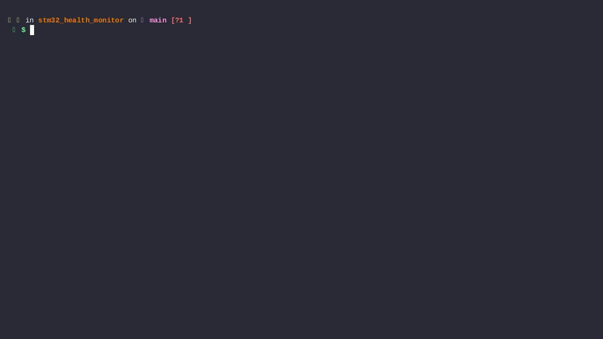
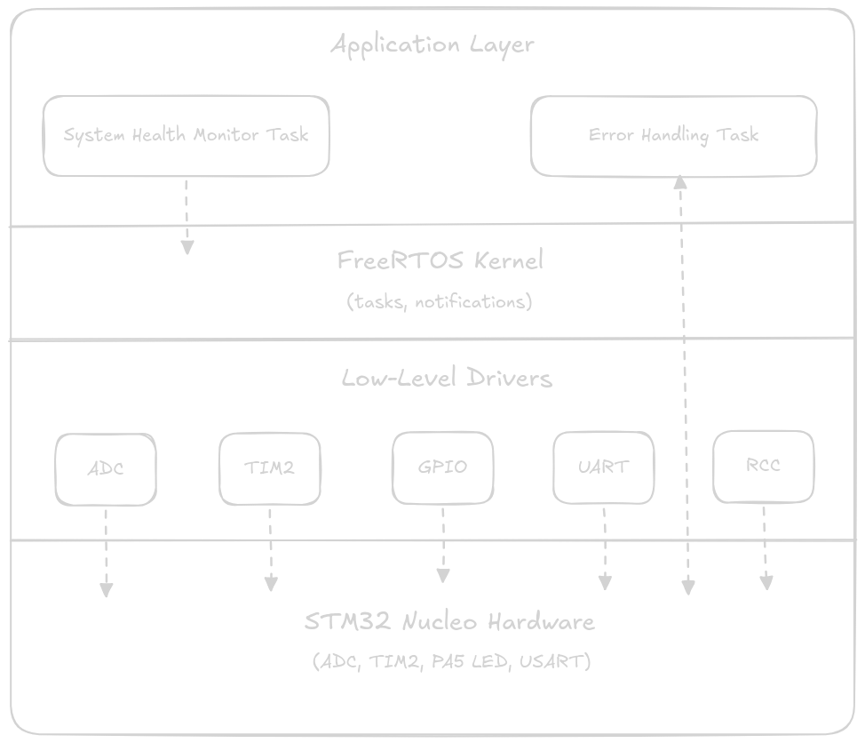

# STM32 Health Monitor

## Introduction
This project began as a way to understand low-level driver development while utilising the real-time concepts using FreeRTOS. This template allows the user to develop FreeRTOS based embedded projects **without** relying on STM32CubeIDE.

## Demo


<sub>*Video 1: Demo*</sub>

## Features
- Low-level driver development for the following peripherals:
  - Reset and Clock Control (RCC)
  - Analog-to-Digital Converter (ADC)
  - General Purpose I/O (GPIO)
  - Timer
  - USART/UART transmission
- **Maximum system clock frequency of 180 MHz** using *Phase Lock Loop (PLL)*
- **Bus clock configuration** for all supported peripherals
- **Internal temperature sensor monitoring**, including:
  - System health monitoring task checks configurable against temperature threshold range
  - ADC to Celsius conversion of raw sensor readings
  - Timer 2 interrupts to trigger ADC conversions
  - Temperature output over UART driver using `make show-temp`
  - Visual error indication using `PA5` user LED
  - Configurable temperature threshold range
- FreeRTOS tasks:
  - Error Handling Task
  - System Health Monitoring Task
- GDB debugging support
- Custom toolchain configuration

## Build Instructions
```
# Install the OpenOCD tool
sudo apt install openocd
sudo apt install picocom

# Compile and build the final executable
cd project
make build

# Flash the microcontroller
make flash
```

## Run Instructions
```
# Show the internal tempe
make show-temp

# Press Ctrl+A and Ctrl+X to exit 'picocom'
```

## Debug Instructions
```
# 1. Launch the debug server
make debug-server

# 2. Open a new terminal window

# 3. Launch the gdb debugger
make debug
```

## Hardware
- STM32F446RE Nucleo Board
- USB A to USB mini B Cable

## System Architecture


<sub>*Fig 1: System Architecture Overview*</sub>
